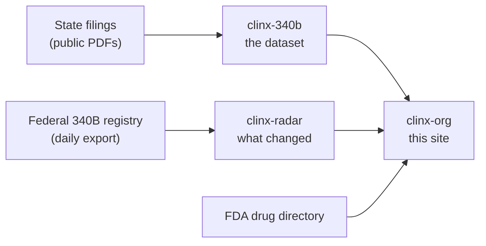

# clinx-org

This is the code for [clinx.org](https://clinx.org), a free website that shows what hospitals and health centers report to their states about the federal 340B drug program.

You do not need to be a programmer to find your way around here. This page explains what the site is, where its numbers come from and where each part lives. The deeper notes are in [`docs/`](docs/), one topic to a page.

## What the site does

- It shows the figures each filer reported: what it paid for 340B drugs, what it was paid, and what went to outside vendors.
- Every figure is a link. It opens the filing's own PDF at the page the figure was read from.
- It gives no opinions. It does not grade a filer or say why a figure is what it is.

Three states are in the scorecard today: Rhode Island, Vermont and Minnesota. Each state has its own form, so the site never adds two states together or sets them side by side as if they were alike.

## Where the numbers come from

The site is the last of three steps. Each step is its own repository, and each can be used without the others.



| Repository | What it is |
|---|---|
| [clinx-340b](https://github.com/VVillBerchtold/clinx-340b) | The dataset. Every figure read from the filings, checked against a second, separate read, and kept with its page number. Corrections are reported there. |
| [clinx-radar](https://github.com/VVillBerchtold/clinx-radar) | A small tool that keeps dated copies of the federal 340B registry and reports what changed between two dates. |
| clinx-org (you are here) | The website. It reads the dataset and draws the pages. It never changes a figure. |

## What the site promises, and how the code keeps each promise

A promise on a web page is easy to make. Each one below is kept by something that runs on every build, so it cannot quietly stop being true.

| The promise | How it is kept | Where to look |
|---|---|---|
| Every figure links to its source | One component draws every cited figure, and it cannot be used without a source link: the type check fails | `src/components/Cited.astro` |
| The data is the dataset's, unchanged | The dataset is copied in with a fingerprint of each file. The build stops if a copied file differs | `scripts/sync-data.mjs`, `scripts/check-data.mjs` |
| No trackers, cookies or outside scripts | The page security policy allows nothing from outside the site. A scan of the built site fails if anything slips in | `public/_headers`, `scripts/check-dist.mjs` |
| A claim count of 1 to 5 is never shown | The dataset leaves it out and the pages say "fewer than 6". The site refuses a dataset copy that holds one | `scripts/dataset-shape.mjs`, `scripts/check-drug-pages.mjs` |
| The pages work with scripts turned off | Tables, charts and the contact form are plain HTML. Scripts only add sorting, search and menus | `src/scripts/` |
| Money never picks up a rounding error | Amounts are whole cents, never decimal fractions | `src/lib/money.ts` |
| Nothing is published by accident | Publishing needs a person to start it and type a confirmation. Every check runs first | `.github/workflows/publish.yml` |

## A map of the folders

| Folder | What is in it |
|---|---|
| `src/pages/` | One file for each page or kind of page. The folder names match the site's addresses. |
| `src/components/` | Pieces the pages share: a cited figure, a table of measures, a meter, the section menu. |
| `src/lib/` | The logic, kept apart from the pages: reading the dataset, money, each state's form, how names are written. |
| `src/data/dataset/` | A copy of the dataset, made by `npm run sync`. Never edited by hand. |
| `src/styles/` | The look. Every colour, typeface and spacing value is in `tokens.css`. |
| `src/scripts/` | The small scripts that run in the browser: sorting, the drug search, menus, the article's demo. |
| `public/` | Files served as they are: the downloads, the security headers, the pictures. |
| `worker/` | The one program that runs on the host. It sends the contact form's message on as an email and keeps nothing. |
| `scripts/` | Tools that run at build time or once a month: the copy step, the checks, the refresh, publishing. |
| `reference/` | Drug names from the FDA's public directory, with a record of the day they were read. |
| `refresh/` | Dated copies of the federal registry for the monthly comparison. They hold no person's name. |
| `tests/` | The tests. Many of them read the whole dataset, not a sample. |
| `docs/` | Longer notes on how things work and why. |

## Run it on your computer

You need Node 22.23.4 or later (the exact version is in `.nvmrc`).

Install what the site needs. Every version is pinned, so you get the same files we do.

```bash
npm ci
```

Then run the checks and build the site into `dist/`.

```bash
npm run check:data && npm run check && npm test && npm run build && npm run check:dist
```

| Command | What it does |
|---|---|
| `npm run check:data` | Confirms the copied dataset is byte for byte what was copied in, and has the shape the site expects |
| `npm run check` | Checks the types in every page and script |
| `npm test` | Runs the tests |
| `npm run build` | Builds every page into `dist/` |
| `npm run check:dist` | Scans the built site for anything that would break a promise above |
| `npm run sync` | Copies a new version of the dataset in. Only needed when the dataset changes |

To see the built site in a browser, with the contact form working (mail is written to a file, not sent):

```bash
deploy/node_modules/.bin/wrangler dev --config wrangler.jsonc
```

## Read more

- [How the site is built](docs/how-the-site-is-built.md): the rules every page follows, and why.
- [How figures and names are written](docs/how-figures-and-names-are-written.md): tidy on the page, untouched in the data.
- [The checks](docs/the-checks.md): what the scan of the built site looks for.
- [Being found](docs/being-found.md): what each page tells search engines, and how that is kept honest.
- [The monthly refresh](docs/the-monthly-refresh.md): how the federal registry and the FDA names are brought up to date.
- [Publishing and the contact form](docs/publishing.md): the host, the go-live switch and the one program that runs there.
- [Changelog](CHANGELOG.md) and [how to contribute](CONTRIBUTING.md).

## Found something wrong?

A wrong figure is a correction to the dataset, not to this site. Please open an issue in [clinx-340b](https://github.com/VVillBerchtold/clinx-340b) that names the filing, the schedule and the line. The PDF governs.

For anything about the pages themselves, open an issue here or write to will@clinx.org.

## Licences

The code is under the MIT licence ([LICENSE](LICENSE)). The data is under Creative Commons Attribution 4.0. The names "ClinX" and "ReferralFinderX", their logos, the fonts and the founder's photograph have their own terms: see [NOTICE.md](NOTICE.md).
