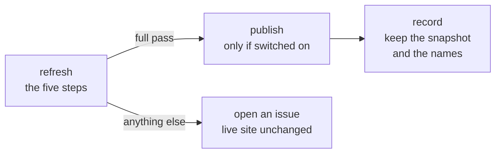

# The monthly refresh

**In short:** once a month a scheduled job brings two things up to date: the copy of the federal 340B registry and the drug names from the FDA's directory. It rebuilds the site and runs every check. If anything looks wrong it stops, opens an issue and leaves the live site exactly as it was.

The state filings are not part of this job. They change only when a new version of the dataset is released and copied in with `npm run sync`.

## When it runs

At 09:17 UTC on the 3rd of each month, or when a person starts it by hand. The schedule is in `.github/workflows/refresh.yml`.

## The five steps

The steps live in one script, `scripts/refresh/refresh.sh`. The script never publishes and never commits; it only says whether the run passed.

| Step | What happens | If it goes wrong |
|---|---|---|
| 1. Pull the export | The [clinx-radar](https://github.com/VVillBerchtold/clinx-radar) tool downloads the registry's public daily export, once | No export: the run stops (exit 4) |
| 2. Make the snapshot | The export is cut down to a small dated file for one state, with every personal field left out | |
| 3. Compare | The new snapshot is compared with last month's and a change report is written | An unusual amount of change: the run stops so a person can read the report (exit 3) |
| 4. Drug names | The FDA's National Drug Code Directory is downloaded once and the names file is rebuilt | Directory not reachable (exit 5), or an unusual amount of change (exit 3): the run stops and nothing is written |
| 5. Rebuild and check | The site is built and every check runs, the same checks as before any publish | Any failed check stops the run |

"Unusual" has a plain meaning in each case: for example, the FDA directory shrinking by more than a tenth, or many codes changing at once. A big change may be real. It may also be a broken download. A person decides, not the script.

## What happens after the steps

- **publish** runs only after a full pass, and only when the repository variable `PUBLISH_ENABLED` is `true`. It publishes the very files the checks passed on.
- **record** runs only after a publish. It commits the new snapshot, the day of the refresh and the drug names, so next month has something to compare with.
- **report-failure** opens an issue that says the refresh did not pass, nothing was published and the live site is unchanged.

## The raw export never enters the repository

The registry's export names people: each entity's contacts. The site has no use for them.

- The export is kept in a temporary folder outside the repository and deleted however the run ends.
- It is never uploaded, logged or committed.
- Only the snapshot leaves the job. It holds no person's name, phone number or email. `refresh/snapshots/` is where the snapshots are kept.

## Proving that a failure publishes nothing

A safety rule that has never been tried is a hope. The job can be started by hand with a "force a failure" box ticked. Every step and check then runs and passes, and the run fails on purpose at the end (exit 9). The drill shows that a failed run publishes nothing and opens its issue.

## The FDA names, by hand

After a new dataset version with new drug codes, the names file can be rebuilt without waiting for the month:

1. Download https://www.accessdata.fda.gov/cder/ndctext.zip and unpack it into a new, empty folder outside this repository.
2. Run `node scripts/reference/build-fda-ndc.mjs <that folder> <today, YYYY-MM-DD> <the zip> [--report <file.md>] [--accept-changes]`.
3. Read the counts and the changes it prints, then run the checks.

Every added, changed, kept and dropped name is listed in the report. `--accept-changes` is for the case where a person has read the report and the unusual change is real.

The directory's files are data. The script copies their text as listed and runs nothing from them.

## One note while the repositories are private

The job reads the clinx-radar repository with a read-only key (`OPAIS_DEPLOY_KEY`). Once that repository is public the key can be deleted and the job works without it.
